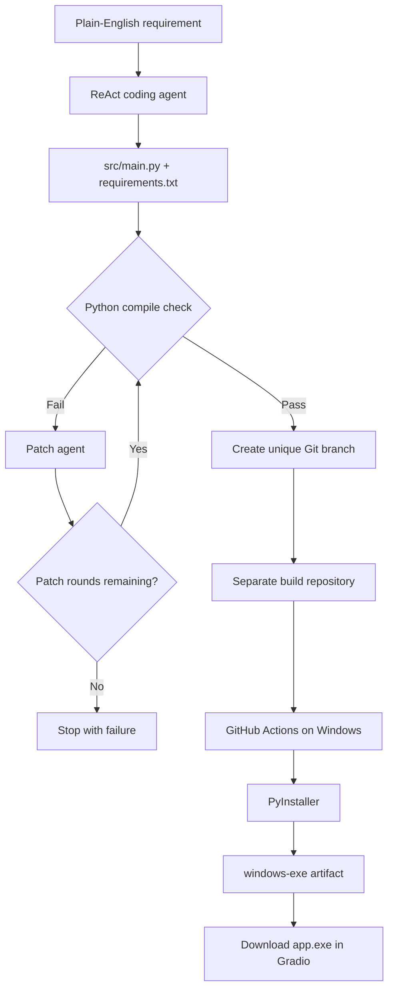
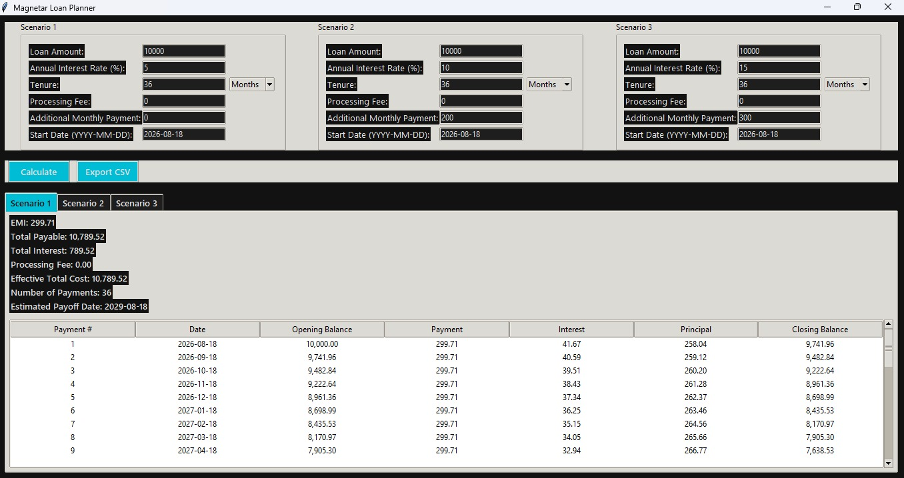
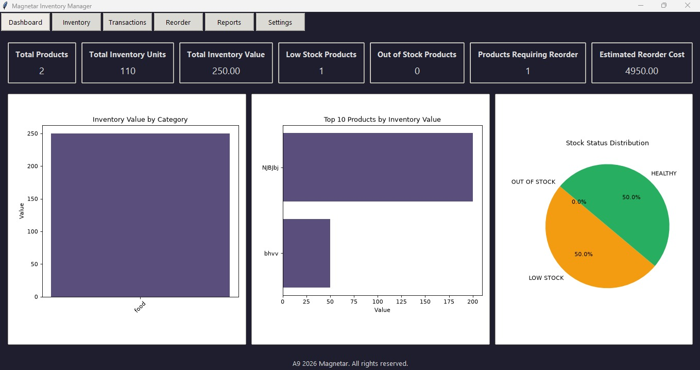
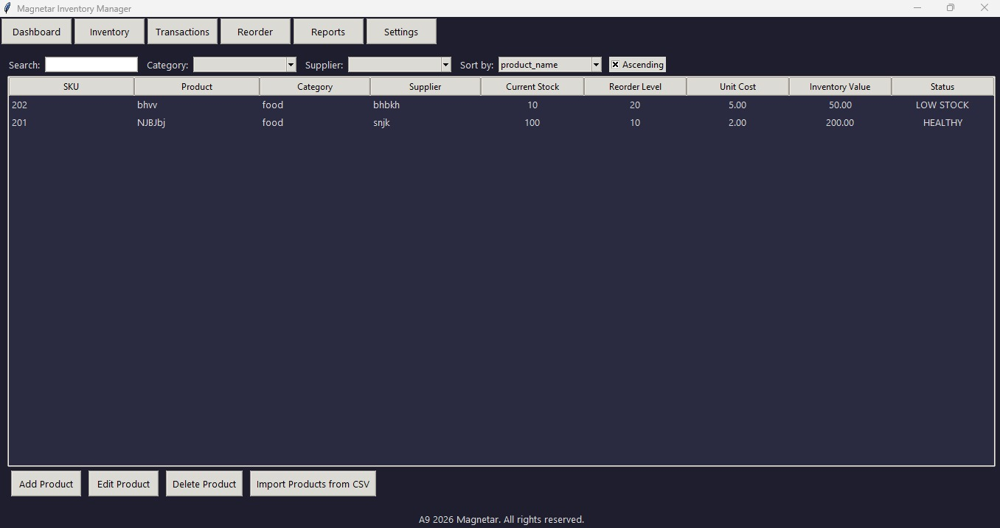
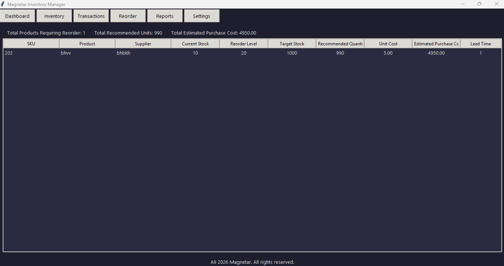
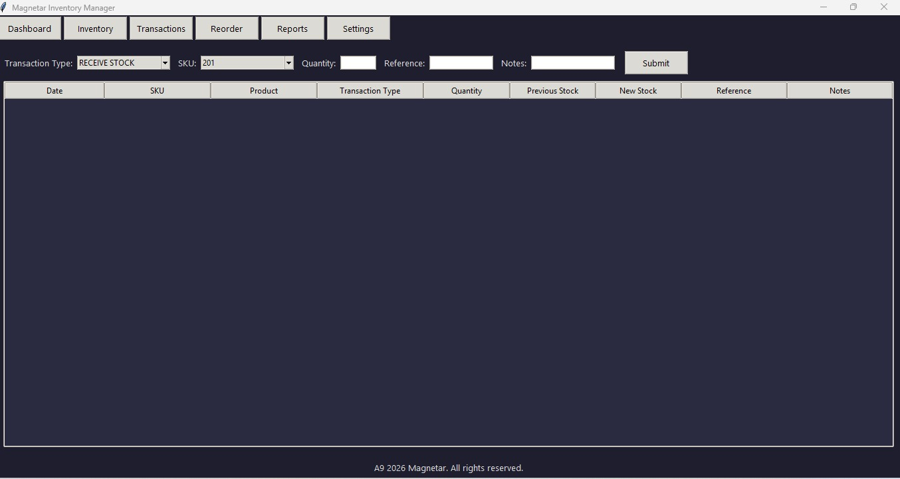
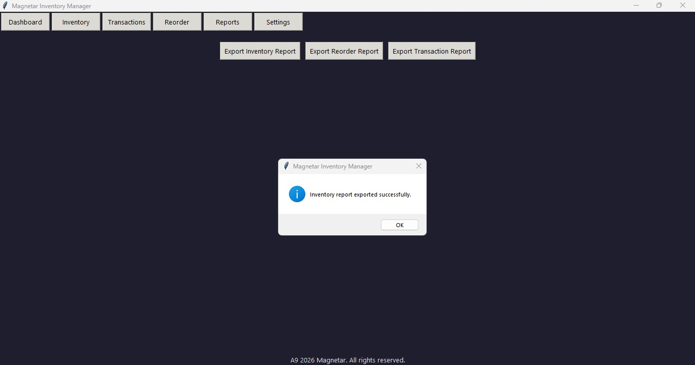
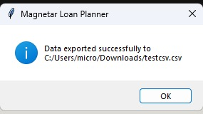
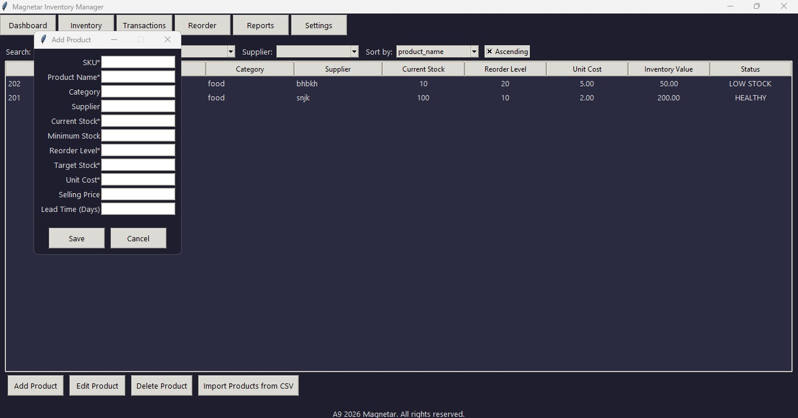
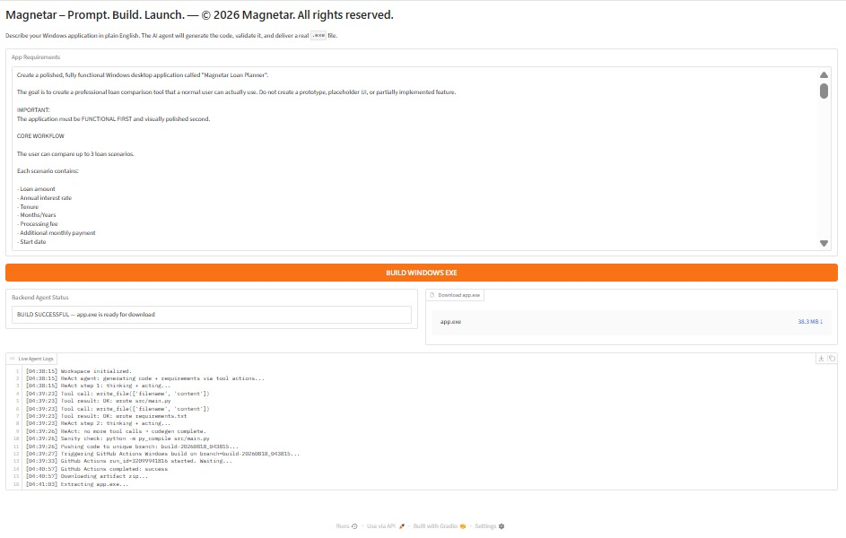

# Build2EXE — Prompt. Build. Launch.

**Turn plain-English requirements into downloadable Windows applications.**

[](#license)
[](https://www.python.org/)
[](https://github.com/shubham-61291/agentic-exe-builder_1)

Build2EXE is an AI-assisted application-generation MVP. A user describes a desktop application in natural language; an agent generates Python source and dependencies, checks the source for syntax errors, attempts bounded repairs when needed, then hands the generated project to a separate GitHub repository for Windows packaging with GitHub Actions and PyInstaller. On success, the resulting `app.exe` is retrieved for download through the Gradio interface.

> **Project boundary:** Build2EXE is an MVP, not a general-purpose software engineer. Its pre-build validation is a Python syntax check, not proof that every feature works correctly. The current workflow targets Python desktop applications packaged for Windows.

## Table of contents

- [At a glance](#at-a-glance)
- [How it works](#how-it-works)
- [Architecture](#architecture)
- [Technology stack](#technology-stack)
- [Demonstration applications](#demonstration-applications)
- [Screenshots](#screenshots)
- [Repository layout](#repository-layout)
- [Run the MVP](#run-the-mvp)
- [Configuration and secrets](#configuration-and-secrets)
- [Validation and limitations](#validation-and-limitations)
- [Security notes](#security-notes)
- [Roadmap](#roadmap)
- [Author](#author)
- [License](#license)

## At a glance

| Capability | Current implementation |
|---|---|
| Input | Plain-English application requirements |
| Code generation | ReAct-style agent using GPT-4.1-mini |
| Generated files | `src/main.py` and `requirements.txt` |
| Pre-build validation | `python -m py_compile src/main.py` |
| Automated repair | Up to four patch rounds after a failed syntax check |
| Build isolation | A unique `build-YYYYMMDD_HHMMSS` branch for each generation |
| Windows packaging | Separate repository and GitHub Actions `windows-latest` runner |
| Executable packaging | PyInstaller, producing `app.exe` |
| Artifact delivery | Downloads the `windows-exe` GitHub Actions artifact and exposes `app.exe` in the UI |
| Interface | Gradio with build status and agent logs |

## How it works

1. **Describe:** The user enters the application requirements in plain English.
2. **Generate:** The coding agent writes `src/main.py` and `requirements.txt` using file tools.
3. **Check:** Build2EXE runs Python's compile check against the generated source.
4. **Repair if needed:** If compilation fails, a patch agent receives the relevant log context and attempts a repair, up to four rounds.
5. **Isolate the build:** The generated source is committed to a unique branch in the build repository.
6. **Package on Windows:** Build2EXE dispatches the GitHub Actions workflow, which installs dependencies and runs PyInstaller on a Windows runner.
7. **Retrieve the artifact:** The orchestration code waits for the workflow, downloads the `windows-exe` artifact, extracts `app.exe`, and makes it available through Gradio.



## Architecture

The system separates application generation from Windows build infrastructure.

| Component | Responsibility |
|---|---|
| **Build2EXE / Gradio** | Captures requirements and presents generation status, logs, and the final executable |
| **LangGraph workflow** | Orchestrates workspace setup, code generation, syntax validation, repair, and build handoff |
| **ReAct coding agent** | Generates the app and dependency list using `write_file` and `read_file` tools |
| **Sanity checker** | Runs `python -m py_compile src/main.py` before the remote build |
| **Patch agent** | Attempts to repair compilation failures, with a maximum of four rounds |
| **Build repository** | Receives the generated source on a uniquely named branch |
| **GitHub Actions** | Builds on `windows-latest`, installs dependencies, invokes PyInstaller, and uploads `windows-exe` |
| **Artifact retrieval** | Downloads the workflow artifact and extracts `app.exe` for the user |

The build workflow lives in a separate repository: [`agentic-exe-builder_1`](https://github.com/shubham-61291/agentic-exe-builder_1). It is not defined by this repository's `README.md` or by the main orchestration source alone.

## Technology stack

| Layer | Technology |
|---|---|
| Language | Python 3.11+ on the Windows build runner |
| Model | GPT-4.1-mini |
| Agent orchestration | LangGraph |
| LLM integration | LangChain, `langchain-openai` |
| User interface | Gradio |
| Source validation | Python `py_compile` |
| Version control | Git and GitHub |
| Build orchestration | GitHub REST API and GitHub Actions |
| Windows packaging | PyInstaller |
| Artifact delivery | GitHub Actions artifacts |
| MVP execution environment | Google Colab |

## Demonstration applications

The repository includes screenshots from two substantial applications used to demonstrate the end-to-end flow. These examples are feasibility demonstrations, not a statistical estimate of generation reliability.

### 1. Magnetar Loan Planner

A desktop loan-planning application generated and packaged as a Windows executable. Its demonstrated features include:

- Comparing up to three loan scenarios
- Loan amount, annual interest rate, and loan tenure inputs
- Months/years selection, processing fees, additional monthly payments, and start date
- EMI, total payable amount, total interest, processing cost, and effective cost calculations
- Payment schedule and estimated payoff date
- CSV export



### 2. Magnetar Inventory Manager

An inventory-management desktop application with a dashboard, product-level stock views, reorder analysis, transaction records, and CSV reporting.

**Dashboard and stock overview**



**Product-level inventory**



**Reorder analysis**



**Stock transactions**



**Inventory report export**



**Downloaded CSV output**



**Adding inventory**



## Screenshots

### Build2EXE interface

The main interface accepts an application requirement and exposes a build action, agent status, live logs, and a downloadable executable field.



### Windows build pipeline

The screenshot below shows a successful GitHub Actions Windows build for a generated application.


## Repository layout

The main repository contains the orchestration source and demonstration evidence:

```text
Build2EXE-DMDP-IIMA-term6-/
├── README.md
├── build2exe.py
├── Build2EXE_input_interface.jpeg
├── Successful_GitHub_Actions_Windows_build.jpeg
├── loan_planner.jpeg
├── Generated_Inventory_Manager_executable.jpeg
├── product_level_stock_information.jpeg
├── reorder_analysis.jpeg
├── transaction_interface.jpeg
├── csv_export_inventory.jpeg
├── csv_downloaded.jpeg
├── inventory_addition.jpeg
├── inventoryreport.csv
├── reorderreport.csv
├── testcsv.csv
├── logapp1.txt
└── logapp2.txt
```

The Windows packaging repository contains the GitHub Actions workflow and the generated application branch structure:

```text
agentic-exe-builder_1/
├── .github/
│   └── workflows/
│       └── build-exe.yml
├── src/
│   └── main.py             # generated per build
└── requirements.txt        # generated per build
```

## Run the MVP

### Execution environment

The current implementation is designed around **Google Colab** and uses Colab's Secrets interface through `google.colab.userdata`. The repository currently publishes `build2exe.py`, but the file contains notebook-specific syntax and is **not a conventional standalone Python script**; running `python build2exe.py` is not a supported setup path. For a reproducible fresh setup, the original notebook should be committed or the implementation should be converted into standard Python modules with a dependency file.

### Required accounts and configuration

- A Google Colab environment for running the orchestration code
- An OpenAI API key for model-backed code generation
- A GitHub token authorized to write to the configured build repository and dispatch its Actions workflow
- Git available in the execution environment
- The separate build repository configured with the Windows workflow

### Colab secrets

Add these values under **Google Colab → Secrets**:

| Secret | Purpose |
|---|---|
| `OPENAI_API_KEY` | Authenticates model requests |
| `GITHUB_TOKEN` | Clones/pushes to the build repository, dispatches Actions, and retrieves workflow artifacts |

The current source pins `requests==2.32.4` and installs these packages at startup:

```bash
pip install -qU langchain langchain-openai pydantic langgraph gradio requests==2.32.4
```

Run the notebook-compatible implementation in Colab and launch the Gradio interface. The current code starts Gradio with `share=True`, which creates a shareable public URL; only use that option when you understand who may access the live demo and what information it exposes.

### Example application requirement

```text
Create a desktop loan planner that compares three loan scenarios, calculates EMI and total interest, displays an amortization schedule, and exports the results to CSV.
```

## Validation and limitations

### What the current validation proves

`python -m py_compile src/main.py` checks that the generated Python file can be compiled. It is a useful early syntax gate, but it does **not** validate runtime behavior, UI correctness, calculation accuracy, application completeness, or dependency compatibility.

The repository includes two demonstrated end-to-end build logs where GitHub Actions completed successfully and the artifact retrieval/extraction steps ran. The screenshots and logs are evidence of those examples, not a guarantee that every arbitrary prompt will produce a working application.

The observed build time documented for the MVP is approximately **5–6 minutes per successful EXE generation**, against a target of under 10 minutes. The initial success benchmark is a target around **60%**, not a measured general reliability result from a statistically designed evaluation.

### Known limitations

- **Ambiguous specifications:** The agent may infer requirements incorrectly when a prompt leaves details unspecified.
- **Syntax-only pre-check:** Compile validation does not replace runtime, UI, functional, or regression testing.
- **Model capability:** Complex applications may exceed what the current model can reliably generate.
- **Platform scope:** The current pipeline packages Python applications for Windows only.
- **Colab dependency:** The current implementation uses Colab-specific secret access and notebook conventions.
- **Build service dependency:** Generation depends on external OpenAI and GitHub services, a configured build repository, and a successful GitHub Actions run.
- **Artifact retrieval:** A successful workflow must upload an artifact named `windows-exe` containing `app.exe` for retrieval to complete.

## Security notes

- Store `OPENAI_API_KEY` and `GITHUB_TOKEN` in Colab Secrets; never commit them to source control.
- Use a dedicated, fine-grained GitHub token with only the repository permissions required for pushing branches, dispatching workflows, and downloading artifacts.
- The current code uses the token in a Git clone URL. Treat terminal output, logs, shell history, and process listings as potentially sensitive; avoid printing credential-bearing URLs and rotate the token if it is exposed.
- The current interface launches Gradio with `share=True`. Do not use a public share URL with sensitive requirements, credentials, or private generated source.
- Review generated source and dependency lists before executing an application. AI-generated code may contain defects or unsafe behavior.
- Treat screenshots, CSV files, and logs as demo artifacts; do not add real customer data or secrets to the public repository.

## Roadmap

Potential next steps for the MVP include:

1. **Structured requirements:** Add a specification stage that converts ambiguous natural-language prompts into a reviewed technical brief.
2. **Runtime verification:** Launch the generated app and run smoke tests before artifact delivery.
3. **Functional checks:** Generate and run tests for key workflows, calculations, and expected outputs.
4. **Repair with regression checks:** Verify that each repair resolves the reported defect without breaking previously passing behavior.
5. **Reproducible setup:** Commit the original Colab notebook or convert the implementation into a standard Python package with a pinned requirements file.
6. **Platform expansion:** Evaluate macOS, Linux, web, and mobile targets only after strengthening the current Windows pipeline.

## Project context

- **Project:** Build2EXE
- **Tagline:** Prompt. Build. Launch.
- **Project brand:** Magnetar
- **Institutional context:** IIM Ahmedabad, DMDP Term 6
- **Year:** 2026

## Author

**Shubham Kumar Singh**

- GitHub: [@shubham-61291](https://github.com/shubham-61291)
- Repository: [Build2EXE-DMDP-IIMA-term6-](https://github.com/shubham-61291/Build2EXE-DMDP-IIMA-term6-)

## License

This project is intended to be distributed under the MIT License. Ensure the repository contains a `LICENSE` file with the full MIT text before relying on the license notice for redistribution.

Copyright (c) 2026 Shubham Kumar Singh

Permission is hereby granted, free of charge, to any person obtaining a copy of this software and associated documentation files (the "Software"), to deal in the Software without restriction, including without limitation the rights to use, copy, modify, merge, publish, distribute, sublicense, and/or sell copies of the Software, and to permit persons to whom the Software is furnished to do so, subject to the following conditions:

The above copyright notice and this permission notice shall be included in all copies or substantial portions of the Software.

THE SOFTWARE IS PROVIDED "AS IS", WITHOUT WARRANTY OF ANY KIND, EXPRESS OR IMPLIED, INCLUDING BUT NOT LIMITED TO THE WARRANTIES OF MERCHANTABILITY, FITNESS FOR A PARTICULAR PURPOSE AND NONINFRINGEMENT. IN NO EVENT SHALL THE AUTHORS OR COPYRIGHT HOLDERS BE LIABLE FOR ANY CLAIM, DAMAGES OR OTHER LIABILITY, WHETHER IN AN ACTION OF CONTRACT, TORT OR OTHERWISE, ARISING FROM, OUT OF OR IN CONNECTION WITH THE SOFTWARE OR THE USE OR OTHER DEALINGS IN THE SOFTWARE.
